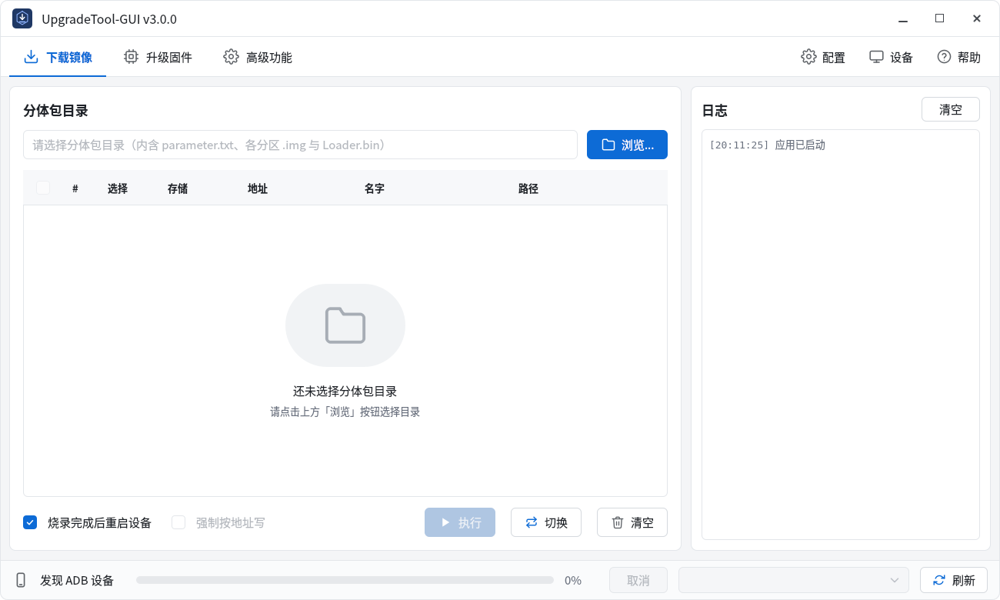
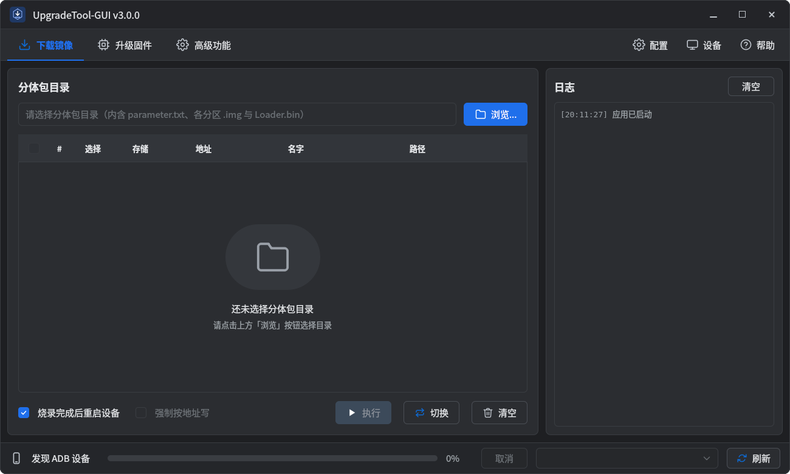

# UpgradeTool-GUI

**English** | [中文](README.zh-CN.md)

Firmware flashing tool for Rockchip (Loader / Maskrom), Allwinner (FEL / FES), and Qualcomm (EDL) devices, built with Qt6 Quick/QML.




## Supported devices

| Vendor | Flashing modes | Pages (1 / 2 / 3) | USB ID |
|---|---|---|---|
| Rockchip | Loader, Maskrom | Download Image / Upgrade Firmware / Advanced | VID `2207` |
| Allwinner | FEL, FES | Raw Image Flash / Flash Firmware / Advanced | `1f3a:efe8` |
| Qualcomm | EDL (9008) | Partition Tools / Download / Tools | VID `05c6` |

## Features

Shared by all vendors:

- Automatic device scan, batch flashing (one vendor per batch, in device order), task progress, cancel, and logging.
- Chinese and English UI, light and dark themes.

**Rockchip**

- Full firmware upgrade, info parsing, and unpacking.
- Boot download and loader upgrade, flashing images by `parameter.txt` partitions.
- Device, flash, chip, OTP, secure-mode, and partition-table queries.
- LBA read/write, sector write, block erase, image export.
- Serial number read/write, serial log export, GPT generation.

**Allwinner**

- Unencrypted IMAGEWTY v1/v2/v3 inspection and unpacking.
- Bare-image and firmware flashing with four modes: partition, keep user data, partition erase, full erase.
- Switch to FEL over ADB from the flashing pages.
- Offline programmer-image conversion for SPI NOR, SD card, eMMC, SD NAND, and UFS.
- Device information and reboot in FES mode.

**Qualcomm**

- qdl-based Sahara and Firehose protocol, with no separate qdl executable.
- Partition tools using qdl addresses, plus Flat Build download from rawprogram and patch XML.
- Switch to EDL (9008) from DIAG ports or authorized ADB devices.
- Dry-run simulation, UFS provisioning, and package creation (zip, archive, digests).

## Usage

Pick a vendor, connect a device in flashing mode, then select the target in the bottom device bar. The UI language follows the system by default; switch between Chinese and English in **Config → Preferences…**.

### Rockchip

| Page | Action |
|---|---|
| Download Image | Select a directory containing `parameter.txt` and images, tick partitions, then run. Partition names are matched to image files; double-click a path to pick one manually. A Loader in the directory is shown in the first row. |
| Upgrade Firmware | Select a firmware package and confirm chip, version, and other info before upgrading. |
| Advanced | Query device info, read/write serial numbers, export logs or images, erase storage. |
| Config | Edit config, generate GPT, install Linux device rules, switch theme. |

### Allwinner

| Page | Action |
|---|---|
| Raw Image Flash | Select a board-matched IMAGEWTY boot firmware and the image to write, with an optional write method (Command / logic offset) and logic offset; always full erase, no verification, reboot when done. |
| Flash Firmware | Select a firmware package and a flash mode (partition / keep user data / partition erase / full erase), with optional verification after write; defaults are full erase, verification on, reboot when done, and a failed verification stops the task. |
| Advanced | View partitions and embedded files, extract firmware, reboot the device in FES mode, convert programmer images (SPI NOR / SD card / eMMC / SD NAND / UFS). |
| Device menu | Query device information. |

The two flashing pages can switch to FEL over ADB: the standard `efex` entry is used by default, a compatible T3 Buildroot entry is auto-detected, or you can force the alternative. After switching, the target USB port is checked to confirm the result, and flashing does not start automatically. Image conversion reads the DTB offset and secure-boot flag automatically and needs no device.

### Qualcomm

| Page | Action |
|---|---|
| Partition Tools | Select a programmer, then add read / write / erase / SHA256 / reset operations by qdl address (`LUN`, `LUN/sector`, `LUN/sector+count`, a partition name, or `LUN/partition-name`) and run them in order; an explicit Firehose reset must be last. |
| Download | Select the build type (Flat Build / Meta) and programmer, then load rawprogram and patch XML with **Load XML** (or **Skip patch**) and click **Download**; use **Ctrl/Shift-click** to select several LUN files, and re-running **Load XML** replaces the previous selection. |
| Tools | Chip info, reset, RAM dump, Sahara kickstart, create ZIP / Sahara archive / VIP digests, and UFS provisioning. |
| Switch settings… / Switch to EDL | Choose the device, switch method, and diagnostic interface (DIAG or authorized ADB), then move the device into EDL (9008) mode. |

The **Load XML** dialog opens in the programmer's folder and the loaded list is read-only. DIAG is not restricted to PID 9091; unknown interfaces can be selected manually but must pass a read-only DIAG query. Qualcomm inputs are session-only and are not written to the configuration. Enabling **Dry run** simulates qdl without accessing a device or writing read-output files; it does not prove hardware support, so validate a real flash and boot separately. A switch attempt is not retried, and success is confirmed only when the device re-enumerates at the same USB location.

### Command-line arguments

```sh
./build/upgrade_tool_gui --firmware /path/to/update.img
./build/upgrade_tool_gui --tab 0 --image-dir /path/to/images
./build/upgrade_tool_gui --vendor allwinner --firmware /path/to/allwinner.img
```

`--vendor` defaults to `rockchip`; other values are `allwinner` and `qualcomm`. `--tab` defaults to `1` and selects the page in vendor order:

| `--vendor` | `--tab 0` | `--tab 1` (default) | `--tab 2` |
|---|---|---|---|
| `rockchip` | Download Image | Upgrade Firmware | Advanced |
| `allwinner` | Raw Image Flash | Flash Firmware | Advanced |
| `qualcomm` | Partition Tools | Download | Tools |

`--firmware` loads a firmware package into the selected page. `--lang` defaults to `auto` (follow the system) and also accepts `zh` or `en`.

## Device permissions

**Linux**: Install the udev rules from **Config**, or run:

```sh
sudo scripts/install-udev.sh
```

The `.deb` installs all vendor rule sets automatically. If you see a permission error, install the rules and reconnect the device. A Rockchip device is recognized when the device bar shows `Vid=0x2207,Pid=0x... Mode=Loader|Maskrom`.

**macOS**: No extra USB driver is needed.

**Windows 10/11 x64**: Open **Device → USB Drivers** to install WinUSB for Rockchip or Allwinner flashing interfaces (administrator permission required). Qualcomm supports existing WinUSB or official QDLoader COM drivers. Reconnect the device or restart Windows if necessary after installation.

Windows/macOS release packages include ADB; the `.deb` installs the distribution's `adb` dependency. Set `ADB` to an executable path or name to override it.

## Build

Requires CMake 3.21.1+, Git, GNU C11/C++20 compilers, and Qt6 (Core, Gui, Quick, QuickControls2, SerialPort). libusb, libzip and libxml2 are statically linked through submodules; zlib comes from the system.

Fetch submodules before the first build:

```sh
git submodule update --init --recursive
```

The Qualcomm backend compiles qdl from `third_party/qdl`: CMake copies the upstream sources into the build tree and applies `cmake/patches/qdl-embedded.patch`, which drops the CLI entry points, adds callbacks and cancellation, replaces fatal parser exits, and gives USB transfers a separate libusb context, so no qdl executable is required. When the submodule revision changes, rebase that patch and re-run the test and packaging checks; never bypass a patch application failure.

The core builds without Qt using `-DUPGRADE_TOOL_GUI=OFF`. Disable individual backends with `-DUPGRADE_TOOL_ROCKCHIP=OFF`, `-DUPGRADE_TOOL_ALLWINNER=OFF`, or `-DUPGRADE_TOOL_QUALCOMM=OFF`.

### Linux

Debian / Ubuntu:

```sh
sudo apt install cmake git g++ zlib1g-dev qt6-base-dev qt6-serialport-dev qt6-declarative-dev qt6-l10n-tools qt6-tools-dev-tools \
  qml6-module-qtquick qml6-module-qtquick-controls qml6-module-qtquick-layouts \
  qml6-module-qtquick-templates qml6-module-qtquick-window \
  qml6-module-qtqml-workerscript qt6-qpa-plugins
```

Install the SVG plugin as `qt6-svg-plugins` or `libqt6svg6`, depending on the distribution.

```sh
cmake -S . -B build
cmake --build build -j
./build/upgrade_tool_gui
```

### macOS (Apple Silicon)

The minimum deployment target is macOS 12; the original Rockchip features are verified on Qt 6.8.3, arm64. Replace `CMAKE_PREFIX_PATH` with your local Qt path:

```sh
cmake -S . -B build-macos -G Ninja \
  -DCMAKE_PREFIX_PATH="$HOME/Qt/6.8.3/macos" \
  -DCMAKE_OSX_ARCHITECTURES=arm64
cmake --build build-macos --parallel
open build-macos/upgrade_tool_gui.app
```

### Windows

Install a Qt6 x64 MinGW kit (including SerialPort, Qt Test, Qt Quick Test and Linguist Tools), its matching MinGW compiler, CMake and Ninja with Qt Maintenance Tool, and install Git for Windows.

The script detects zlib and Iconv headers/static libraries in the matching MinGW installation. For separate installations, pass `-ZlibRoot <prefix>` and `-IconvRoot <prefix>`. Run from an ordinary PowerShell:

```powershell
./scripts/package_windows.ps1
# Check dependencies without building
./scripts/package_windows.ps1 -CheckEnvironment
```

The portable is written to `<build-dir>/dist/UpgradeTool-GUI-v<version>-windows-x64-portable.exe`.

### Tests and packaging

```sh
cmake -S . -B build -DUPGRADE_TOOL_TESTS=ON
cmake --build build -j
ctest --test-dir build --output-on-failure

# Linux: build a .deb via Docker, for Ubuntu 22.04 and newer
scripts/package_deb.sh

# Linux: build a .deb with the host toolchain; current distro only
UPGRADE_TOOL_NATIVE_DEB=1 scripts/package_deb.sh

# macOS: build a standalone app and DMG; output in build-macos/dist/
QT_ROOT="$HOME/Qt/6.8.3/macos" scripts/package_macos.sh
```

macOS packaging requires system support for `diskutil image create/attach`; the app is ad-hoc signed, without developer signing or notarization.

## Configuration and logs

`config.ini` is searched in order: user config directory → executable directory → the macOS app's `Contents/Resources/`. Saving in **Config** writes to the user config and takes effect immediately.

Default Linux paths:

- Config: `~/.config/upgrade_tool/config.ini`, following `XDG_CONFIG_HOME`.
- Logs: `~/.local/state/upgrade_tool/log/`, following `XDG_STATE_HOME`.

The config format is `key=value`, with lines starting with `#` as comments. The repository config is fully commented and uses default behavior.

| Key | Meaning |
|---|---|
| `lba_parity` | LBA transfer parity check |
| `rb_check_off` | Disable write read-back verification |
| `nor_single_idb` | Single IDB for NOR |
| `log_off` | Disable logging |
| `stdout_buffer_off` | Disable stdout buffering |
| `force_data_band` | Force data bandwidth |
| `log_dir` | Log directory |
| `firmware` | Default path when no recent firmware is saved |
| `loader` | Default path when no loader is specified for an operation |
| `device` | Kept for compatibility; the target device is chosen in the device bar |

## License

| Component / source | License | Reference |
|---|---|---|
| rkdeveloptool | GPL-2.0 | [backends/rockchip/legacy/license.txt](backends/rockchip/legacy/license.txt) |
| libusb | LGPL-2.1 | `third_party/libusb/COPYING` |
| libwdi | LGPL-3.0-or-later | `third_party/libwdi/COPYING-LGPL` |
| OpenixCLI | MIT | [backends/allwinner/LICENSE.OpenixCLI](backends/allwinner/LICENSE.OpenixCLI) |
| libefex | MIT | [third_party/libefex/README.md](third_party/libefex/LICENSE) |
| qdl | BSD-3-Clause | [third_party/qdl/LICENSE](third_party/qdl/LICENSE) |
| libzip | BSD-3-Clause | `third_party/libzip/LICENSE` |
| libxml2 | MIT | `third_party/libxml2/Copyright` |

The license files and READMEs of the bundled third-party components take precedence.
